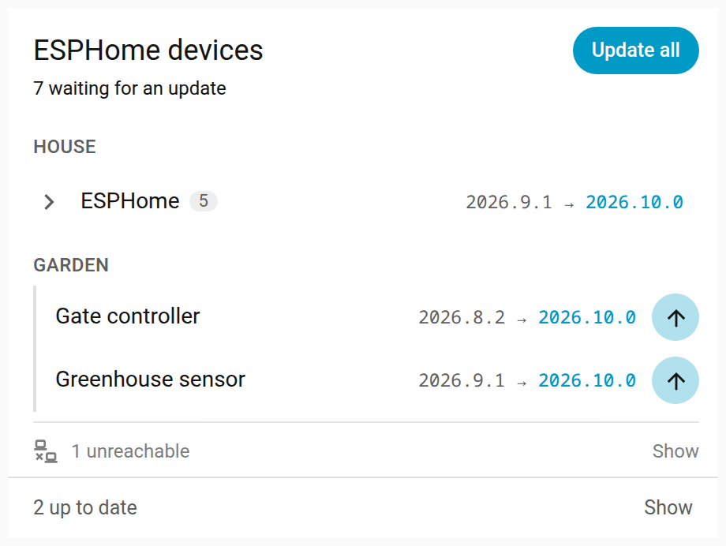
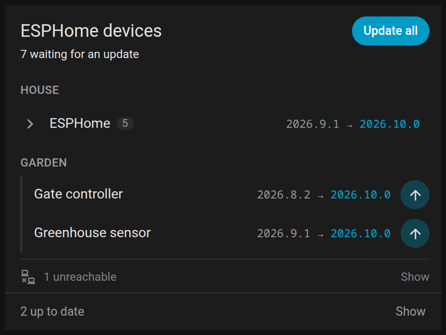
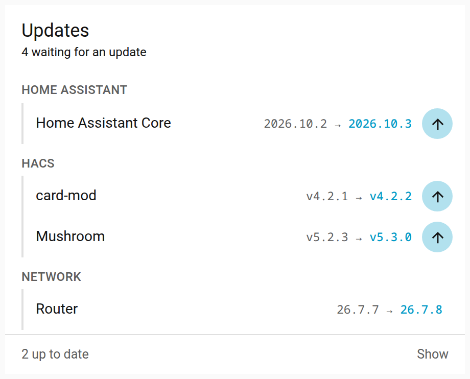
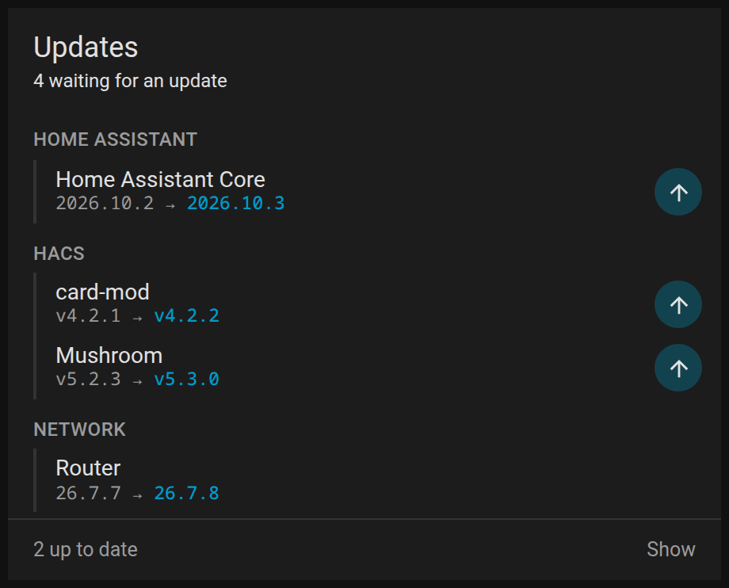
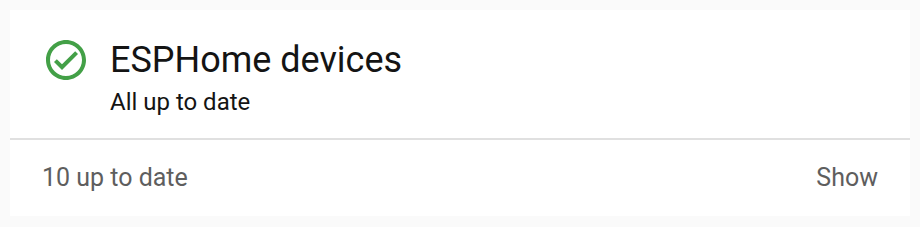
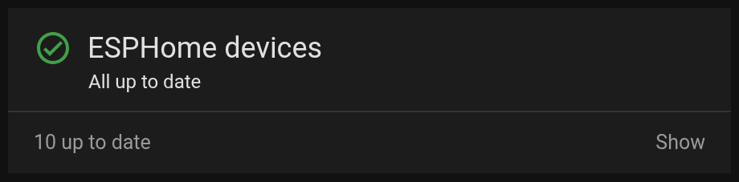
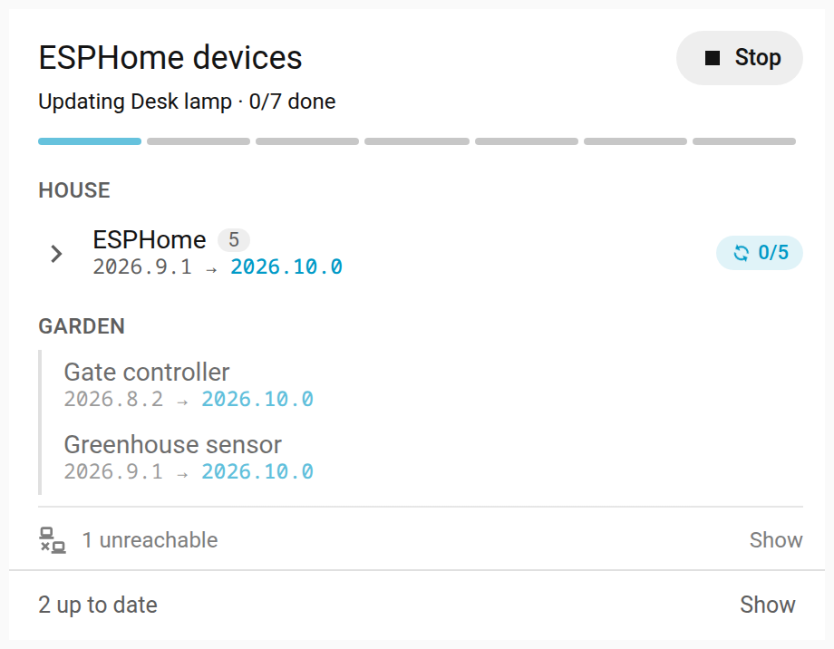
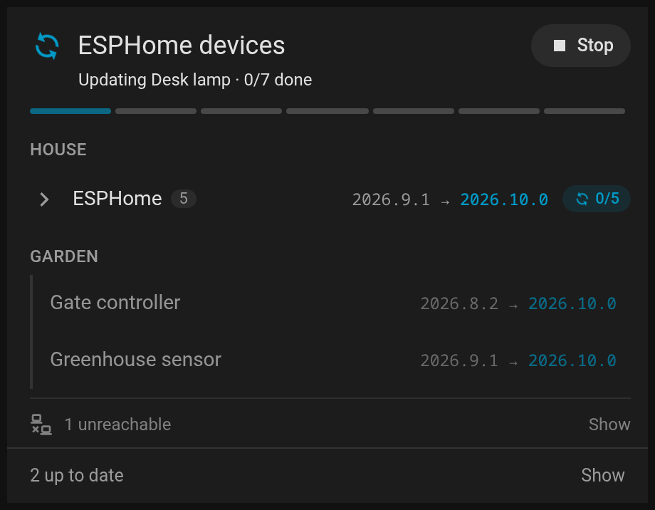

# Updates card

Home Assistant dashboard card for update entities, in groups, folded away under one line when nothing is waiting.

[![GitHub Release][releases-shield]][releases] [![GitHub Release Date][release-date-shield]][releases] [![Downloads][downloads-shield]][releases] [![Marketplace][marketplace-shield]][marketplace] [![License][license-shield]](LICENSE)

<p>




</p>

## What is it?

A card for Home Assistant's `update` entities, such as the firmware of ESPHome, Zigbee or WLED devices, Marketplace downloads,
Home Assistant itself, or anything else that has an update entity. It shows them in groups you choose, by integration, by area or
by a list of entities.

Most of the time everything is up to date, and the card says so under a check, with a line that opens to the devices. When updates come in, each
group shows only what is waiting. When many devices wait for the same release, as every ESPHome device does when
ESPHome releases, they fold into one row that opens to them all.

Each row has its own install button, and the card installs one row at a time. Updating everything is left to an action
of your own, such as a script that installs one device after another and skips the ones that are offline. While such
a script runs, the card follows it, shows how far it has got, hides the rows' buttons so nothing installs alongside
it, and offers to stop it.

Updates that have no update entity can go in too, as a sensor that counts them, such as a server's waiting packages, and
a problem sensor that says something needs attention.

## Installation

### With the Marketplace

1. Open Settings › Marketplace and search for Updates card
2. Open it and choose Install
3. Refresh your browser

### Manual

1. Take `dist/updates-card.js` from the source code of the [latest release][releases] and copy it to the `config/www`
   folder of your Home Assistant installation
2. In Home Assistant settings, open dashboards, click the three dots at the top right and open resources
3. Add a new resource with the path `/local/updates-card.js` and type JavaScript
4. Refresh your browser

## Options

Every option can be set in the card's visual editor, except `height_mode`, `height` and `max_height`, which are set in
YAML. In a sections view the layout tab sets the card's height. They are for where there is no layout tab, such as a
masonry or panel view, or a stack or other card the card is inside, even in a sections view.

| Name             | Type   | Description                                                                                                                                                                                                                                                                                                      | Default                                                                         |
| ---------------- | ------ | ---------------------------------------------------------------------------------------------------------------------------------------------------------------------------------------------------------------------------------------------------------------------------------------------------------------- | ------------------------------------------------------------------------------- |
| `title`          | string | The card's title                                                                                                                                                                                                                                                                                                 | "Updates" in the viewer's language                                              |
| `groups`         | list   | The groups, each with the options below                                                                                                                                                                                                                                                                          | Every update entity in one group                                                |
| `names`          | list   | Names of your own for single rows, each an `entity` and the `name` its row shows instead of the one the card gives it                                                                                                                                                                                            |                                                                                 |
| `install_action` | action | What the **Update all** button does, as any dashboard action. A script is followed while it runs (below). Without it, there is no such button                                                                                                                                                                    |                                                                                 |
| `height_mode`    | string | How tall the card is. `auto` fits its content, `fixed` keeps it at `height`, `max` lets it grow up to `max_height`. In `fixed` and `max` the list scrolls. A height in grid rows, set in the layout tab of a sections view, is used instead                                                                      | `fixed` when `height` is set, `max` when only `max_height` is, otherwise `auto` |
| `height`         | number | The card's height in pixels, for `fixed`                                                                                                                                                                                                                                                                         |                                                                                 |
| `max_height`     | number | The card's greatest height in pixels, for `max`                                                                                                                                                                                                                                                                  |                                                                                 |
| `row_step`       | string | How the card rounds its height on automatic rows in a sections view, with `height_mode` `auto` or `max`. `full` rounds up to whole rows, with the room left over under the header, and `half` to half rows, which saves space but may leave the cards under it half a row off the rows of the sections beside it | `full`                                                                          |

A group holds the update entities of an integration, in some areas or outside them, or exactly the entities listed.

| Name               | Type   | Description                                                                                                                                                                 |
| ------------------ | ------ | --------------------------------------------------------------------------------------------------------------------------------------------------------------------------- |
| `name`             | string | Shown above the group. Without one, the group has no heading                                                                                                                |
| `integration`      | string | Only update entities of this integration, such as `esphome` or `marketplace`                                                                                                |
| `areas`            | list   | Only update entities in these areas, by the entity's own area or else its device's                                                                                          |
| `exclude_areas`    | list   | No update entities from these areas                                                                                                                                         |
| `entities`         | list   | Exactly these entities, instead of the integration and areas. Besides update entities, sensors that count waiting updates and binary sensors that tell of a problem (below) |
| `exclude`          | list   | Entities never shown in the group                                                                                                                                           |
| `list_attribute`   | string | The attribute of a count sensor that lists what waits                                                                                                                       |
| `reason_attribute` | string | The attribute of a problem sensor that tells what the problem is, as a text or a list of them                                                                               |
| `age_attribute`    | string | The attribute that tells how many days the oldest update has waited                                                                                                         |
| `age_days`         | number | From how many days on, by `age_attribute`, the row's count is shown in orange                                                                                               |

Update entities hidden in Home Assistant are left out, except when listed in `entities`. Sensors and binary sensors are
taken only from `entities`, never by the integration or the areas.

## What it shows




**Nothing waiting.** A check before the title, the status line, and a line counting the devices up to date. Tapping
its **Show** opens every update entity, muted, by group, with its version.

**Updates waiting.** Each group shows the rows with an update, with the version installed and the one available. A
line at the bottom opens the rest. Three or more rows of a group that update the same software to the same version
fold into one row, named after the software, which opens to all of them. The same software means the same integration
and the same title, which an update entity gives for the software it updates. Every ESPHome device's says "ESPHome".
An entity without a title updates its integration's software, unless its device is a service, as each Marketplace
download is, which is software of its own. So two Marketplace cards never fold together. The card compares versions
only as text and never reads them as numbers, so any kind of versioning works.

**Installing a row.** The row's button calls `update.install` for that entity alone. While it installs, the other
buttons wait, so two installs never run at once from the card. A device reboots after its firmware is written, so the
row keeps showing "Updating" until the new version shows, for up to three minutes. A row whose version hasn't moved by
then shows that the update failed. An entity whose integration can't install updates has no button, and a tap on any
row opens its details.




**Updating all.** The **Update all** button runs `install_action`. When the action runs a script, by its own name
(`script.update_devices`) or with `script.turn_on` on one script, the card follows the script while it runs. It hides
the rows' buttons, counts what it has updated, and offers **Stop**, which asks first and then turns the script off. The
count covers every waiting row the card can install, so a script that leaves some of them out ends short of the total.

**Unreachable devices.** An update entity counts as unreachable when it is unavailable, or when each of its device's
other entities is unavailable or is a connection sensor that is off. Such rows go on a line of their own at the end of
their group, and don't count as waiting. The status line counts them instead. ESPHome, for one, keeps a sleeping device's update
entity available, and its status sensor too, which turns off. That is why the device's other entities are asked, and
why a connection sensor counts by what it says.

**Counts and problems.** A sensor listed in a group's `entities` counts updates that have no update entity, such as a
server's waiting packages. It waits while its state is above zero and shows the state with its unit, and at zero it is
up to date. With `list_attribute`, its row opens to the list. With `age_attribute` and `age_days`, its count turns orange
once the oldest update has waited that long. A binary sensor listed there tells that something needs attention, such as
a reboot. It shows only while it is on, with what its `reason_attribute` says. Neither has an install button, and neither
counts for **Update all**.

**Names.** A row is named after its device, as the entity's own name adds only "Firmware" to it. When a device has more
than one update entity, each row is named after both the device and the entity, to tell them apart. When an update
entity shares its device with another entity of the group, its row takes the entity's name alone. A count or problem
sensor's row is named after its device. `names` gives any row a name of your own.

**A device that isn't there.** The card lists update entities, and Home Assistant creates a new ESPHome device's update
entity disabled. Such a device shows once its update entity is enabled in the device's settings.

## Sizes

The card takes a whole section by default and can be made as narrow as half of one. Below 300 pixels, the **Update
all** button shows only its icon. From 700 pixels on, the groups go side by side, two to a row.

Held to a height, by `height_mode` or by rows in a sections view, the header, the status line and the line of those up
to date stay in view and the groups scroll between them. The title, the status line, the group names and that line then
keep to one line each, cut short with an ellipsis when they are longer, with the whole text as a tooltip. The card never
gets lower than these and one group's first row need, which is four rows in a sections view. Longer names and versions scroll the rest of the first row
with the list. While an **Update all** script runs, its progress bar takes its room from the list.

With nothing waiting, a card held to a set height, fixed or in rows, shows a check under the line of those up to date,
with a line for each named group with devices saying how many of them are up to date and how many are unreachable. The groups without a
name share a line when a named group has one too. When there are more lines than fit, they scroll.

On automatic rows in a sections view the card takes whole rows, so the cards under it stay on the rows, or with
`row_step: half` half rows. The room left over goes under the status line. With `max_height`, it grows the same way up
to that height rounded down to its rows, so it stays on the rows when it reaches it too.

## Examples

### ESPHome devices at home and at a summer cottage

A script that updates one reachable device after another, and the card on top of it.

```yaml
type: custom:updates-card
title: ESPHome devices
groups:
  - name: Home
    integration: esphome
    exclude_areas: [cottage]
  - name: Cottage
    integration: esphome
    areas: [cottage]
install_action:
  action: perform-action
  perform_action: script.update_esphome_devices
max_height: 600
```

### Everything Home Assistant itself and the Marketplace update

```yaml
type: custom:updates-card
title: Updates
groups:
  - name: Home Assistant
    integration: hassio
  - name: Marketplace
    integration: marketplace
```

### A few entities by hand

```yaml
type: custom:updates-card
groups:
  - entities:
      - update.router_firmware
      - update.nas_firmware
```

### Servers' packages

Each server reports its waiting packages to a sensor, with the packages listed and the oldest one's age in attributes,
and a problem sensor for a reboot it needs.

```yaml
type: custom:updates-card
title: Servers
groups:
  - entities:
      - update.web_server_os
      - sensor.web_server_packages
      - binary_sensor.web_server_problem
      - sensor.media_box_packages
      - binary_sensor.media_box_problem
    list_attribute: packages
    reason_attribute: reasons
    age_attribute: oldest_days
    age_days: 60
names:
  - entity: update.web_server_os
    name: Web server OS
```

## Translating

The card's texts are in `src/localize/languages/`, one JSON file per language, named by its language code. English
and Finnish are there. To add a language, copy `en.json`, translate its texts and open a pull request.

## Development

Requires Node 22.13 or newer.

```
npm install
npm run check
```

`npm run check` typechecks, lints, checks formatting, runs the tests and builds `dist/updates-card.js`, which is the
file the Marketplace installs and is committed to the repository.

| Path                      | What it contains                                                                    |
| ------------------------- | ----------------------------------------------------------------------------------- |
| `src/updates-card.ts`     | The card itself, and how it follows installs                                        |
| `src/editor.ts`           | The visual editor                                                                   |
| `src/updates.ts`          | Choosing each group's entities, the rows, unreachable devices, folding and statuses |
| `src/height.ts`           | The height mode, shared with the author's other cards                               |
| `src/rows.ts`             | Rounding to the rows of a sections view, shared with the author's other cards       |
| `src/fade.ts`             | The fading edges of what scrolls, shared with the author's other cards              |
| `src/localize/languages/` | The card's texts, one JSON file per language                                        |
| `docs/screenshots.json`   | The made-up data the README's screenshots are taken from                            |
| `tests/`                  | Tests, run with vitest                                                              |

## Support

Hey dude! Help me out for a couple of :beers: or a :coffee:!

[](https://www.buymeacoffee.com/jesmak)

## License

MIT, see [LICENSE](LICENSE).

[releases-shield]: https://img.shields.io/github/release/jesmak/updates-card.svg?style=for-the-badge
[release-date-shield]: https://img.shields.io/github/release-date/jesmak/updates-card?style=for-the-badge
[releases]: https://github.com/jesmak/updates-card/releases
[downloads-shield]: https://img.shields.io/github/downloads/jesmak/updates-card/total.svg?style=for-the-badge
[marketplace-shield]: https://img.shields.io/badge/Marketplace-Default-green.svg?style=for-the-badge
[marketplace]: https://my.home-assistant.io/redirect/marketplace_repository/?owner=jesmak&repository=updates-card&category=plugin
[license-shield]: https://img.shields.io/github/license/jesmak/updates-card.svg?style=for-the-badge
